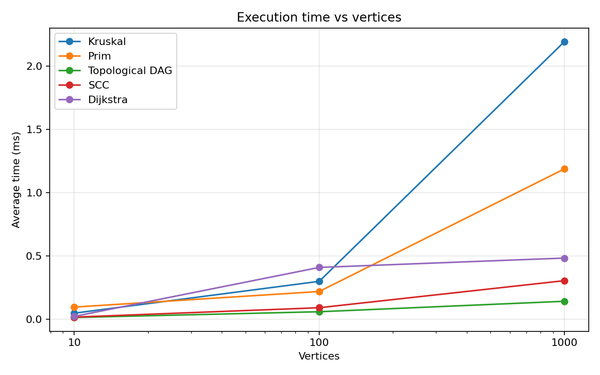
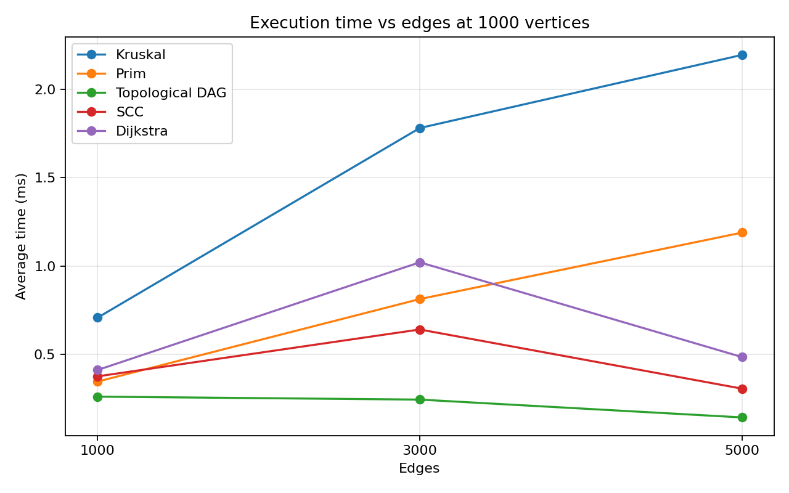

# Assignment 3: Smart City Infrastructure and Route Planning

Name: Maussymzhan Makazhan  
Group: SE-2527

## Overview

This project models city districts as graph vertices and roads as weighted edges.
Undirected roads are used for minimum spanning trees and shortest routes.
Directed roads are used for topological ordering and strongly connected components.

The project implements Kruskal, Prim, Kosaraju, topological ordering, and Dijkstra.
It uses Java 17 and Maven.

## Implementation

`Graph` stores an adjacency list and an edge list. An undirected edge is stored
once in the edge list and in both adjacency lists. Edge weights cannot be negative.

- Kruskal sorts edges by weight and uses DSU to avoid cycles. DSU uses path
  compression and union by size.
- Prim starts at a district and repeatedly chooses the cheapest available road
  with a priority queue.
- Topological ordering uses indegrees and a queue. If it cannot process every
  vertex, the directed graph has a cycle.
- Kosaraju runs DFS twice, with the second pass on reversed edges, to find SCCs.
- Dijkstra uses a priority queue to find distances from one source. It also
  stores the previous vertex so that a route can be printed. Unreachable
  vertices have no route.

Kruskal and Prim return a minimum spanning forest when the graph is disconnected,
and their `connected` flag is false. The demo in `Main` prints MST weights,
routes, topological order, and SCCs.

## Complexity Analysis

`V` is the number of vertices and `E` is the number of edges. The graph uses an
adjacency list, and the priority queues are binary heaps.

| Algorithm | Time | Extra space | Reason |
| --- | --- | --- | --- |
| DSU `find` and `union` | `O(alpha(V))` amortized | `O(V)` for DSU | Compression and union by size keep trees shallow |
| Kruskal | `O(E log E + E alpha(V))` | `O(V + E)` | Sort edges, then use DSU |
| Prim | `O(E log V)` | `O(V + E)` | Each road can enter the priority queue |
| Topological ordering | `O(V + E)` | `O(V)` | Count indegrees and process each edge |
| Kosaraju SCC | `O(V + E)` | `O(V + E)` | Two DFS passes and a reversed graph |
| Dijkstra | `O((V + E) log V)` | `O(V + E)` | Priority queue with possible stale entries |

`alpha(V)` grows extremely slowly, so a DSU operation is almost constant time
in practice. For Prim and Dijkstra, the stated bounds assume a simple graph.
In this implementation the priority queue may contain old entries; it skips
them when they are removed. Larger `V` means more districts to visit, and
larger `E` means more roads to examine.

Dijkstra requires non-negative weights. With a negative road, a distance
already treated as final might later become smaller, so the algorithm's
greedy choice would not be safe.

## Experimental Setup

The required sizes are 10 vertices and 30 edges, 100 and 500, and 1000 and
5000. To study the effect of edges separately, I also tested 1000 vertices
with 1000 and 3000 edges.

Graphs use fixed seeds (42 for roads and 142 for directed graphs), adjusted
by `V` and `E`, so the same graphs can be generated again.
The undirected graph starts with a chain connecting all vertices and then adds
unique random roads. Weights are integers from 1 to 100. The DAG has a
forward chain and more edges from lower to higher vertex numbers. The cyclic
directed graph has a chain plus one edge from the last vertex back to 0, then
more random directed edges. All graphs have exactly the stated number of edges.

Graph creation and correctness checks happen outside the timed part. Each
algorithm has three warm-up runs, then five timed runs with
`System.nanoTime()`. The CSV contains their average time in milliseconds.
`edge_checks` counts examined edges. Kruskal counts edges considered after
sorting, so its sorting work is included in time but not in that counter.
`dsu_find_calls` counts DSU find calls, including recursive calls. For
topological ordering, indegree construction and edge processing are counted.
For SCC, reverse-graph construction and both DFS passes are counted.

## Results

Average time from one run on my computer, in milliseconds:

| V | E | Kruskal | Prim | Topological DAG | SCC | Dijkstra |
| ---: | ---: | ---: | ---: | ---: | ---: | ---: |
| 10 | 30 | 0.049 | 0.097 | 0.015 | 0.018 | 0.024 |
| 100 | 500 | 0.301 | 0.221 | 0.061 | 0.092 | 0.411 |
| 1000 | 5000 | 2.193 | 1.188 | 0.143 | 0.306 | 0.485 |

Selected operation counts from the same runs:

| V | E | Kruskal edge checks | Kruskal DSU finds | Prim edge checks | SCC edge checks | Dijkstra edge checks |
| ---: | ---: | ---: | ---: | ---: | ---: | ---: |
| 10 | 30 | 10 | 28 | 60 | 90 | 60 |
| 100 | 500 | 220 | 820 | 1000 | 1500 | 1000 |
| 1000 | 5000 | 2356 | 8881 | 10000 | 15000 | 10000 |

At 1000 vertices, changing only the number of edges gave:

| E | Kruskal | Prim | Topological DAG | SCC | Dijkstra |
| ---: | ---: | ---: | ---: | ---: | ---: |
| 1000 | 0.707 | 0.346 | 0.261 | 0.376 | 0.411 |
| 3000 | 1.780 | 0.813 | 0.244 | 0.641 | 1.020 |
| 5000 | 2.193 | 1.188 | 0.143 | 0.306 | 0.485 |

The full 30-row table, including topological ordering on cyclic graphs, is in
[results.csv](results/results.csv).





## Comparison and Discussion

Kruskal and Prim produced the same MST weight on every connected graph.
In these measurements Prim was faster on the medium and large cases. Kruskal
must sort all edges first; Prim works from the current connected part.
The edge counters are not a direct measure of total time because they count
different work and do not include queue or sorting comparisons.

SCC and topological ordering are linear in `V + E`, which matches their
edge counts. The cyclic graph has no vertex with indegree zero, so topological
ordering detects the cycle after the indegree pass. Dijkstra and Prim use
priority queues and usually need more work than a simple traversal.

Some times do not increase smoothly when `E` grows. Five short JVM timings
can be affected by JIT compilation, garbage collection, and system activity.
Operation counts are more stable and show the expected growth. These small
timings should not be treated as a precise speed ranking on every computer.

## Testing

`mvn test` runs nine JUnit tests. They cover a small known MST, disconnected
graphs, equal edge weights with multiple possible MSTs, random connected
graphs, a DAG, a directed cycle, SCC membership, unreachable vertices,
negative-weight rejection, and a single vertex. The random MST test compares
the total weights returned by Kruskal and Prim.

## How to Run

From the project folder:

```text
mvn clean test
mvn -q exec:java
mvn -q exec:java "-Dexec.args=bench"
python plot_results.py
```

The third command regenerates `results/results.csv`. The last command
regenerates the two PNG plots and needs Python with Matplotlib installed.
Times will differ between computers.

## Conclusion

Use Kruskal or Prim when planning a low-cost network of roads. Use
topological ordering when directed tasks must follow dependencies, and SCC
when checking which places can reach each other. Use Dijkstra for shortest
routes when all road weights are non-negative.
